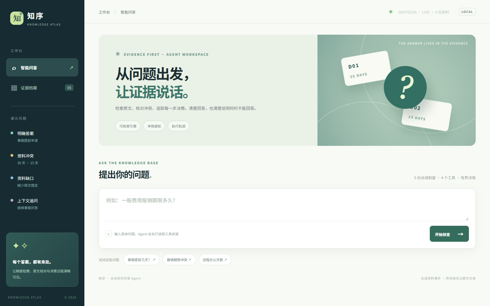
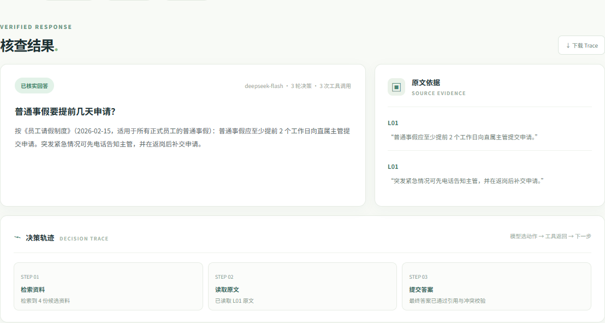
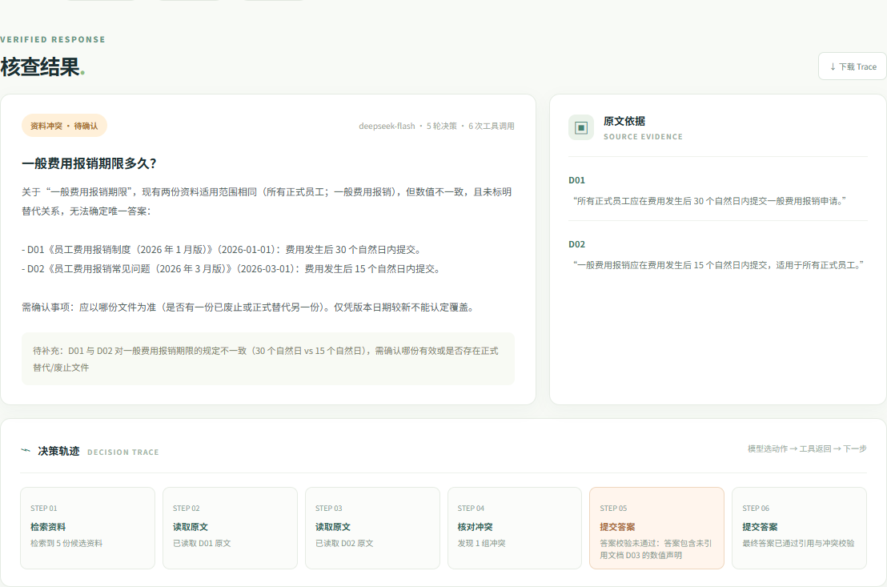
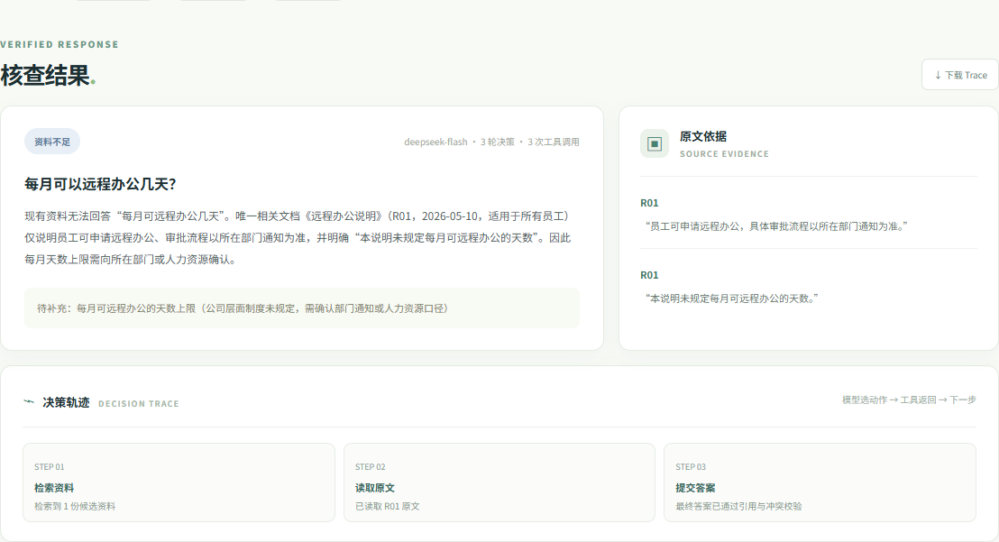
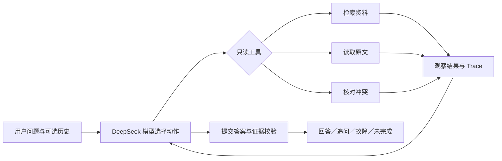

# 证据优先的企业知识问答 Agent

面向制度/FAQ 问答的可运行 Agent，提供本地展示界面与可复现 CLI。Agent 使用真实模型选择“检索 → 阅读原文 → 核对冲突 → 回答/追问/停止”的下一步动作；程序提供只读工具、执行上限、逐字引用验证和可复查 Trace。资料全部是合成示例，不含真实公司信息。

> 当前交付状态：离线 Mock 流程、真实 DeepSeek 模型运行、自动测试和文档均已完成。`examples/mock/` 与 `examples/live/` 严格区分；真实运行的首次冲突回答暴露了未引用旁支事实，修复与复测记录一并保留。2026-10-30 的补充审计见 [`docs/03-evaluation.md`](docs/03-evaluation.md)。仓库地址为 <https://github.com/ZaZaYuan/enterprise-knowledge-qa-agent>；最终验收提交以仓库的 `main` 分支 SHA 为准。

## 实际运行截图

截图来自本地展示界面和**真实 DeepSeek 调用**，不是设计稿或离线 Mock。界面只在 `127.0.0.1` 监听；截图中的资料为合成制度。

| 问答工作台 | 有依据的明确答案 |
| --- | --- |
|  |  |

| 冲突说明与决策轨迹 | 资料缺口与补充问题 |
| --- | --- |
|  |  |

图片能展示界面，实际模型路径、修正与失败记录请查看 `examples/live/` 的 JSON Trace。

## 启动本地展示界面

先按下节设置 `DEEPSEEK_API_KEY`，在项目根目录运行：

```powershell
python webui.py --provider deepseek --port 8765
```

打开 <http://127.0.0.1:8765>。左侧示例可一键运行正常回答、报销冲突、资料缺口和上下文追问；结果区同屏显示答案、原文引用、待补事项和工具轨迹，并可下载完整 Trace。页面会保留当前会话最近 8 条问答作为追问上下文，刷新页面后清空。无需真实模型时可用 `python webui.py --provider mock` 验证界面，但状态会显示 `OFFLINE · MOCK`，其结果不能用作真实模型效果证据。按 `Ctrl+C` 停止服务。

展示服务使用 Python 标准库 `ThreadingHTTPServer`，仅绑定本机回环地址，不对公网开放。`GET /api/health` 返回模型模式和资料数量，`POST /api/ask` 接收 `{ "question": "...", "history": [...] }` 并返回与 CLI 相同的答案及 Trace；密钥始终由服务端环境变量读取，不发送到浏览器。网页里的演示问题仅用于快速触发真实查询。

## 30 秒运行

需要 Python 3.11。程序仅使用标准库，无需安装第三方依赖：

```powershell
python main.py list-docs
python main.py ask "普通事假要提前几天申请？" --provider mock
python main.py ask "一般费用报销期限多久？" --provider mock --trace run-output/conflict.json
python main.py ask "那紧急情况呢？" --provider mock --history examples/context-history.json
python -m unittest discover -s tests -v
```

上面的 `mock` 是显式的离线流程验证。真实模型运行方式：先在 **PowerShell 当前终端** 安全输入新密钥，不把明文粘贴进命令历史、源码、`.env` 或 GitHub：

```powershell
$env:DEEPSEEK_API_KEY = Read-Host 'DeepSeek API Key' -AsSecureString | ConvertFrom-SecureString -AsPlainText
python main.py ask "一般费用报销期限多久？" --provider deepseek --trace run-output/deepseek-conflict.json
```

可选 `DEEPSEEK_MODEL` 和 `DEEPSEEK_BASE_URL`；默认分别为 `deepseek-flash` 和 `https://api.deepseek.com`。接入使用 DeepSeek Chat Completions 的函数工具调用，并关闭 thinking 以使用 `tool_choice=required`；这些接口选项依据 [DeepSeek 官方 API 文档](https://api-docs.deepseek.com/api/create-chat-completion/)（2026-10-30 核对）。若账号不支持默认模型，按控制台可用型号设置 `DEEPSEEK_MODEL`。API 调用可能产生费用。程序不会打印密钥或将密钥写入 Trace。

## 项目结构

```text
main.py                         CLI 入口
webui.py                        本地展示服务入口
web/                            问答工作台 HTML/CSS/JS
src/knowledge_agent/
  agent.py                      有界模型决策循环、引用和冲突校验
  providers.py                  DeepSeek HTTP 适配器、明确标记的离线 Mock
  store.py                      合成文档、中文字符二元组检索、冲突核对
  tools.py                      模型可选工具和参数校验
  cli.py                        终端输出和 JSON Trace 保存
  web.py                        本机 HTTP 展示服务
data/documents.json             带 ID、版本、范围与原文的合成制度
tests/test_agent.py             可执行自动测试
examples/mock/                 输入、实际输出、完整 Trace
examples/live/                 真实 DeepSeek 输出与 Trace
docs/screenshots/              真实运行界面截图
docs/                          需求、方案、评估、AI 使用和复盘
```

提交材料位于同一个仓库。`requirements.txt` 记录核心运行无第三方依赖；`.env.example` 仅列出变量名，不含密钥。`run-output/` 被 Git 忽略，供本机试运行。可用 `python examples/generate_mock_examples.py` 重建 Mock 示例。



| 题目验收点 | 实现与可核查证据 |
| --- | --- |
| 模型选择动作并根据结果调整 | `agent.py` 有界循环；`examples/live/live-conflict-final.json` 包含被护栏拒绝后模型修正的步骤 |
| 至少两种执行路径 | 普通事假“检索→读原文→回答”；一般报销“检索→读两份原文→核冲突→修正并追问” |
| 引用、资料缺口和任务状态 | CLI 和网页同时展示；每份引用逐字核对已读文档 |
| 冲突、资料不足、工具失败 | `examples/live/` 保存真实输出与 Trace，`docs/03-evaluation.md` 记录结果 |
| 相似问法与上下文追问 | `live-paraphrase`、`live-follow-up`；历史只接受最多 8 条 user/assistant 文本 |
| 防无限执行 | 默认 9 次模型决策、12 次工具调用，到上限返回明确的 `incomplete` |
| 工程交付 | 标准库测试、GitHub Actions、合成资料、五份指定文档与真实截图 |

## 交互、工具与约束

工具有 `search_docs(query, top_k)`、`read_doc(doc_id)`、`check_conflicts(doc_ids)` 和终止工具 `submit_answer(...)`。每次工具调用都要求 `basis`，只记录一句可公开的动作依据，例如“发现两个期限，需要核对原文”；Trace 保存步骤、工具参数、返回摘要、完整结果和最终状态，**不记录模型内部思维过程**。

文档含 `id`、`version`、`scope`、`status`、`supersedes`、分段原文与结构化声明。检索采用可解释的中文字符二元组匹配，返回候选 ID、范围、版本和摘要；模型再决定读哪些原文、是否改写查询、是否核对冲突。相同主题、相同范围、不同值且没有显式替代关系时，`check_conflicts` 标记为 `unresolved`。**较新的日期本身不能自动覆盖旧文档。**

最终答案的 `status` 为 `answered`、`conflict`、`insufficient` 或 `tool_error`；执行上限会返回 `incomplete`，模型 API 故障返回 `model_error`。确定性答案必须有逐字存在于已读取文档中的引用；同主题候选资料必须完成原文核对和冲突检查。冲突结论必须引用双方原文。校验不通过会将错误交回模型，直到修正或达到上限。默认最多 9 次模型决策、12 次工具调用，可通过 `--max-steps`、`--max-tools` 调整。`--fail-tool search_docs` 用于故障演示。

## 三条主要验收路径

1. **明确答案**：问“普通事假要提前几天申请？”。模型检索并读取 L01；答案应为至少提前 2 个工作日，并引用 L01 原句。
2. **资料冲突**：问“一般费用报销期限多久？”。D01 写 30 个自然日，D02 写 15 个自然日，范围相同且没有显式替代关系；应列出两处原文、标记冲突并请求确认，不擅自选择 15 天。
3. **资料不足或故障**：问“每月可以远程办公几天？”时，R01 明确未规定天数，应说明缺口；用 `--fail-tool search_docs` 模拟检索故障时，应给出工具故障而非猜测。

另外提供“事假需要提前多久报批？”相似问法、“差旅报销应在返程后几天提交？”范围区分，以及带 `--history examples/context-history.json` 的“那紧急情况呢？”上下文追问样例。输入、实际输出和 Trace 见 [`examples/README.md`](examples/README.md)、`examples/mock/` 与 `examples/live/`。`OFFLINE_MOCK` 只是固定脚本，不可作为真实模型决策质量的证据；`examples/live/` 保存实际 DeepSeek 运行，包括首次冲突回答的不足与修正过程。

## 测试与评价

```powershell
python -m unittest discover -s tests -v
python examples/generate_mock_examples.py
```

18 项自动测试检查正常路径有引用、冲突不因较新日期被静默消除、不同范围不误判冲突、资料不足不编造、工具故障区分、伪造引用被拒绝、达到上限明确返回未完成，以及网页的正常响应、输入拒绝和未知路径处理。真实模型的评估记录和未达预期情况填写在 [`docs/03-evaluation.md`](docs/03-evaluation.md)。

## 已知限制与安全边界

- 合成资料仅覆盖少量制度；字符二元组检索不等同于企业级语义检索，改写问题可能漏召回。
- 冲突工具目前以相同 `claim.key` 和完全相同的 `scope` 为主要判定条件；复杂的范围包含、法律效力和制度优先级须由更完整元数据或人工确认。
- 程序验证**引用是否真实出现在原文中**及是否已读/查冲突，不能形式化证明每个自然语言结论都被引用语义蕴含。资料不足时应保守追问。
- 不接入内部真实文档、账号、权限系统或线上部署。输入真实公司材料前应先完成权限与隐私设计。
- 模型选择下一步动作；程序的强制引用、冲突和步数校验是必要的业务护栏，不声称这些固定校验等同于模型自主决策。

## 提交说明

本题要求单独 GitHub 仓库 URL 与最终 commit SHA。仓库为 <https://github.com/ZaZaYuan/enterprise-knowledge-qa-agent>；`main.py`、`src/`、`data/`、`tests/`、`examples/`、`docs/`、依赖说明和 README 位于同一仓库。`.github/workflows/ci.yml` 在 push 与 pull request 时运行标准库测试和 Mock 示例。不要提交密钥或真实隐私数据。最终填写已核对的仓库 URL 与 SHA，不能沿用上一题的仓库或提交号。
